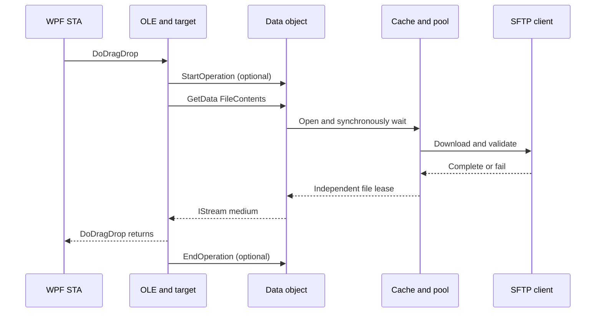

# Shell drag: concurrency, cancellation and ownership

Status: **incomplete acceptance**. Interactive Explorer and UI responsiveness under a stalled remote server have not been tested. The synchronous `GetData` callback still waits for complete, verified staging. `Task.Run` moves SFTP work to the pool but does not release the COM caller. A synchronous target or COM apartment dispatch onto the WPF STA can therefore still freeze the source UI. Async extraction is an optional negotiation with the target, not a guarantee. No full nonblocking behavior is claimed.

The target may call `GetData` before `DoDragDrop` returns or on its chosen apartment. `IDataObjectAsyncCapability` permits, but does not force, background extraction; see [Microsoft's Shell data scenarios](https://learn.microsoft.com/en-us/windows/win32/shell/datascenarios) and [IDataObjectAsyncCapability](https://learn.microsoft.com/en-us/windows/win32/api/shldisp/nn-shldisp-idataobjectasynccapability). The `Read`/`Seek` methods of the returned staged file are synchronized with its `Dispose`; no thread is forcibly interrupted. `CopyTo` invokes the receiver outside that stream lock.

## Ownership and state

The view tracks a cancellation delegate per drag. Closing the tab or disconnecting calls the registry's `Stop`, outside the registry lock. The drag owns one cache and an optional extra COM self-reference. `StartOperation` is accepted once while the drag is active. `EndOperation` plus return from `DoDragDrop` normally triggers one cleanup. On cancellation, cleanup may run after `DoDragDrop` returns even if `EndOperation` is absent. A late `EndOperation` is harmless. Cleanup is deferred while a `GetData` callback is active; after cleanup new callbacks are rejected.

A dropped target may not call `EndOperation`. Once the drag has returned and no `GetData` callback is active, an idle timer bounds retention of the source's self-reference and cache. Another `GetData` resets the timer; a callback that is already active prevents expiration. Expiry is logged and requests cache cancellation. The target's own COM references are not revoked, and already issued streams retain their individual cache leases. A client that remains idle beyond the limit and then requests more data receives a failure; configure a larger limit for long workflows. A held stream alone does not reset the idle timer.

Each staged file is reserved against a 16 GiB per-drag quota. A single file's callers share one download; each successful open receives its own file position. The cache retains staging files while there are active downloads or reader leases; cleanup attempts deletion after both reach zero. A COM `Release` does not deterministically dispose the managed stream: the .NET finalizer may delay release of its lease. The timer does not forcibly close streams that a recipient still holds.

## Cancellation and timeout

The cache cancellation token reaches `DownloadFileWithinLimitAsync`, the shared-client semaphore and the guarded SFTP copy. `CancelAsync` sets cancellation synchronously and executes registered callbacks asynchronously, so a blocking callback does not itself hold the caller; callback errors are logged. Repeated cancellation is idempotent. Timeout, tab closure and drag cancellation request cancellation for the whole drag; cancellation of one waiting request alone does not cancel other waiters.

The timeout defaults to 1,800 seconds for an individual complete staging wait and for the abandoned-operation idle timer. Set environment variable `TELECLAV_SHELL_TIMEOUT_SECONDS` to an integer from 30 through 86400 before launching the application to change both; invalid values fall back to the default. This is a total wait limit, not a progress-sensitive network timeout: a large but active download can time out, so choose the limit to suit the connection. Timeout is logged and cancels the cache.

SSH.NET's synchronous `OpenRead` and `Read` cannot necessarily be interrupted by a cancellation token while blocked. The wait can end, but the underlying download and its staging directory may remain until the library call returns. The SFTP client is shared with the tab's other operations, so this code does not forcibly disconnect it solely to stop one drag. Tab/session disconnection can dispose the shared client using the existing SFTP disconnect mechanism, but this does not prove a hard bound on an arbitrary stuck library call. A surviving download can hold the SFTP client lock; diagnose the warning and connection state rather than assume it stopped.

Escape before drop and a refused target end the drag; absent an asynchronous operation the ordinary return triggers cleanup. Closing the tab or stopping the registry cancels the whole drag. A failure returned by a target or by the network is reported through existing error handling. Individual-file cancellation by an external target and application termination during an unresponsive native call are not guaranteed; partial destination files are under the target's control. Folder planning has its own cancellation token and is cancelled if the mouse button is released or the view is disposed.

## Verification and remaining work

Windows tests cover cancellation without `EndOperation`, callback cancellation without waiting for an intentionally blocked callback, idle expiration, a callback active during the idle window, late completion, repeated cancellation, and reading an issued stream after cancellation. The existing cache tests include concurrent requests, a cancellation-ignoring download, repeated staged transfers and quota/size failures; the lifetime stress test races completion and return 1,000 times. See PR and CI for exact results. These are not a measurement of process memory, handle growth, Windows Explorer or an unresponsive SSH server. Tests of UI responsiveness, real network loss, Explorer cancellation, application shutdown, and sustained memory/handle behavior remain necessary.
