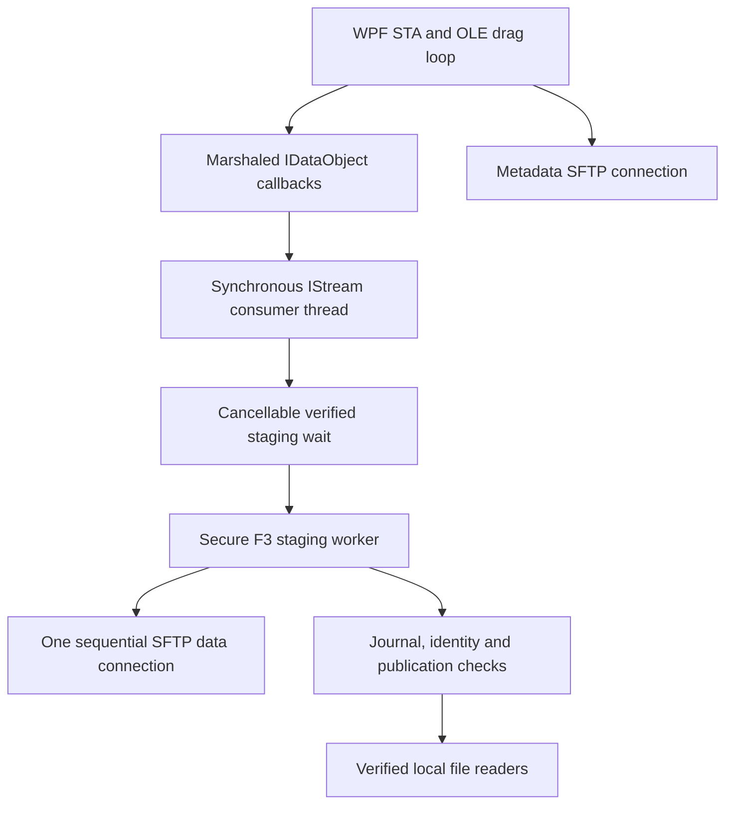

# Shell and SFTP asynchronous lifetime (F9)

Base: F8 PR #17, `aefdee4007e30d0a0ff156ea184ce06507100573`.
Implementation and final CI SHA are recorded in dependent draft PR #18. No merge is performed.

## Execution model

`IStream.Read` and `Seek` are synchronous COM operations. Their caller can wait for complete verified staging. Dispatching preparation to a worker does not make a direct call on the WPF thread nonblocking. Teleclav does not pump nested Dispatcher frames inside production stream reads, and does not return unverified partial content. The native cross-process tests exercise the actual marshaled interface; 100 ms and 3 s delayed downloads are released by a producer Dispatcher timer. This checks that transport configuration permits producer Dispatcher progress while the external consumer waits. It is not interactive Explorer acceptance.

## Confirmed defects and fixes

* A full transfer held the metadata `_clientLock`. The real OpenSSH test pauses a download and requires concurrent directory listing within three seconds. It failed for both key and password authentication on the F9 red commit `daf4e5baf5b530a7a33f5003724e162b9b4d8410` (CI #98). Data copying now uses a separate sequential connection; short metadata operations retain the original lock.
* A deferred reader could remain blocked after cancellation if its opener ignored the token. Waiting now observes the stream cancellation token independently. A late successful opener is still disposed by the existing deferred ownership path. Already verified readers remain usable after cancellation; lifetime activity admission applies only to pending staging.
* One ordinary exception from a cancellation callback could prevent later registered transfers from being stopped. Stop now logs and continues for both ordinary and aggregate exceptions.
* The staging timeout was an absolute wait, rejecting an actively progressing slow transfer. Positive writes now refresh the batch inactivity clock. A test downloads for longer than its idle threshold and requires success.
* Waiting for staging now counts as active COM work, preventing idle lifetime cleanup during an active request. Open readers continue to retain existing F3 ownership.

## Connections and cancellation

Each browser has at most one metadata client and one sequential data client, in addition to the existing temporary host-key probe during initial connection. The data client is reused after success. Uploads and downloads share its cancellable semaphore; another tab has its own browser. No concurrent requests are issued through this data client by separate transfers. The SSH terminal retains its existing independently owned connection.

Every new data connection uses the existing connection factory, authentication parameters and pinned host-key verifier. Password and key authentication remain supported. Refused additional sessions fail the operation explicitly; no exec, Python, `/proc`, host-key weakening or unbounded connection pool is introduced.

Cancellation first requests cooperative termination. After a two-second grace period it asynchronously aborts only the isolated data connection if its lease is still active. In SSH.NET 2026.0.0, ordinary Dispose closes the SFTP channel before closing its transport and can itself wait for replies. The factory-owned client uses its protected disconnect hook to skip that graceful channel step during isolated abort: BaseClient closes the transport, then SftpClient.Dispose releases the SFTP session and the factory releases owned authentication resources. No private reflection or shared client abort is used. This lets normal copy loops and upload rollback finish promptly while allowing blocked network reads to be interrupted. Failed or cancelled connections are closed before the lane is released; the next operation obtains a fresh verified connection. Session disconnect cancels the associated data context. Token callbacks never synchronously wait for socket shutdown.

A vendor disposal call or an arbitrary local destination write that never returns cannot safely be forcibly killed. Its lane remains quarantined and its writer retains ownership until it unwinds. No second data connection is admitted over that lane, and staging is not deleted under an active writer. Socket closing is an interruption mechanism, not a hard real-time thread termination guarantee.

## Distinct timeouts

| Limit | Meaning |
| --- | --- |
| `TELECLAV_SHELL_TIMEOUT_SECONDS` | Batch staging inactivity, reset by positive byte writes; default 30 minutes, accepted range 30–86400 seconds. Not a total transfer deadline. |
| `TELECLAV_SHELL_COM_IDLE_SECONDS` | COM inactivity/lifetime fallback; same default and range, independently configurable. Active staging requests retain activity. |
| SSH.NET factory exchange timeout | Existing 15-minute per-exchange network bound, preserved on the isolated client. Not a total file deadline. |
| Cancellation grace | Two seconds before isolated connection abort is requested. Does not promise synchronous disposal completion in two seconds. |
| Semaphore wait | Cancellable by caller and session lifetime; no separate absolute queue deadline. |

Batch-wide progress can keep another request in the same batch waiting. Network exchange limits and explicit cancellation still apply. A continuously progressing large transfer is not failed solely because its total duration exceeds the staging inactivity limit.

## Verification and remaining acceptance

Implementation SHA `175f9ad47f93e9dcf2952e6e24396d1c82d04e60` passed the three OpenSSH integration tests in CI #99. The subsequent relay and verified-reader regressions require final-head CI; see PR #18. Crapper, Dryer and Mutator metrics were not obtained for C#. The local format workspace could not open its MSBuild named pipe; Windows CI retains the mandatory formatting gate.

Local Release compilation and 28 targeted SFTP regression tests pass. Separate portable harnesses reproduced and then passed the cancelled deferred wait, continuing cancellation registry, and progress timeout cases using the actual changed sources. Windows-native tests and complete regression are mandatory CI gates; final results and exact implementation SHA belong to PR #18.

The Windows gate includes delayed native cross-process consumers, existing async/sync/no-EndOperation/consumer-crash/cancel/large-offset modes, deferred cancellation and error tests, registry callbacks and progressing staging. The existing ownership, replacement, crash recovery and multiprocess staging suites remain mandatory. The real Ubuntu OpenSSH suite tests concurrent listing, cancellation and a subsequent successful verified retry for both authentication methods, plus upload regressions. A transparent loopback TCP relay preserves end-to-end SSH authentication and host-key checking while withholding replies on the selected data connection. The test requires cancellation within ten seconds, metadata listing while replies are withheld, cancellation of a queued request without another connection, and a new successful transfer with matching SHA-256. The relay selects the active data connection after the existing temporary host-key probe; it does not assume the first accepted connection carries metadata.

| Scenario | Status before final CI | Evidence / limit |
| --- | --- | --- |
| Targeted SFTP regressions | PASS | Local Release: 28 passed |
| Cancellation and progress reproductions | PASS | Actual-source local red/green harnesses |
| Windows native COM and staging regression | Pending | Required final-head CI; see PR #18 |
| OpenSSH concurrent listing | RED reproduced | CI #98 on test-only commit; final-head green required |
| Interactive Windows 11 Explorer and terminal responsiveness | NOT TESTED | Requires interactive desktop acceptance |
| Withheld TCP data replies | Pending | Controlled loopback relay; final-head OpenSSH CI required |
| Arbitrary nonreturning vendor disposal | NOT TESTED | A finite fault test cannot prove all third-party shutdown paths |

F3 creation, persistent journal, identity validation, flush, publication, reader ownership and cleanup protocols are retained. The only staging write addition is an in-memory positive-progress notification after the existing write/ownership hook. No journal format change or parallel temporary-file system is introduced.

SSH.NET teardown ordering was checked against the pinned [2026.0.0 SftpClient source](https://github.com/sshnet/SSH.NET/blob/2026.0.0/src/Renci.SshNet/SftpClient.cs) and [BaseClient source](https://github.com/sshnet/SSH.NET/blob/2026.0.0/src/Renci.SshNet/BaseClient.cs). CI #101 reproduced the ordinary Dispose abort failing the ten-second cancellation bound with both authentication methods. The protected-hook fix must pass that unchanged bound. Microsoft documents [asynchronous extraction as a consumer-coordinated optional contract](https://learn.microsoft.com/en-us/windows/win32/api/shldisp/nn-shldisp-idataobjectasynccapability); enabling it does not turn a synchronous direct IStream read into an asynchronous call.
